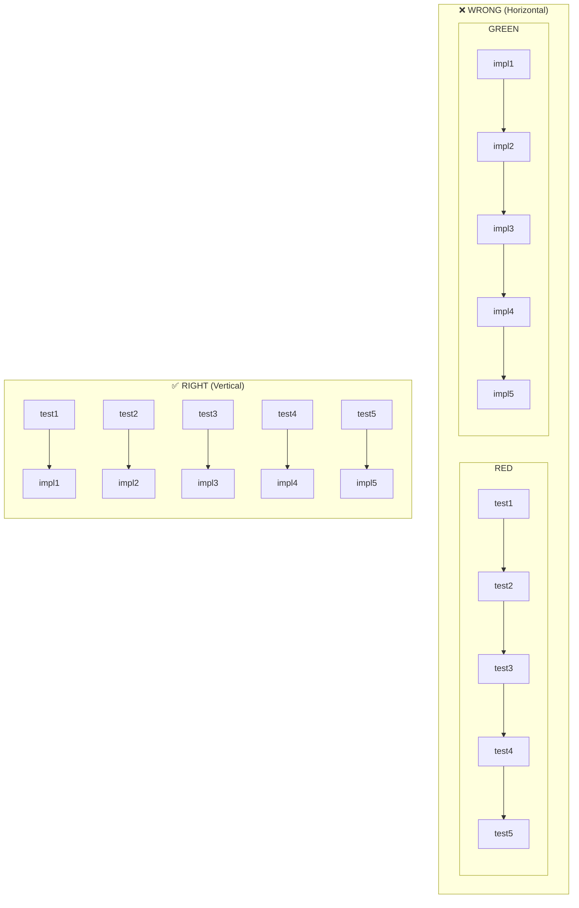
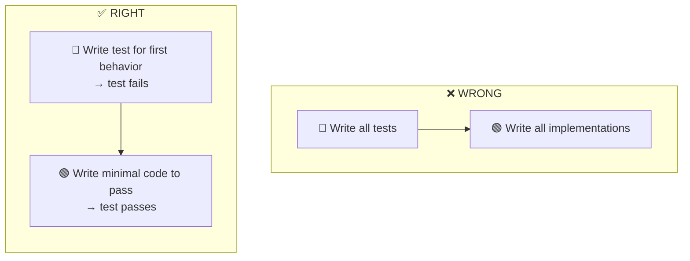
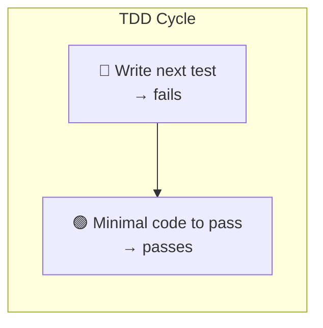

# Test-Driven Development

## Philosophy

**Core principle**: Tests should verify behavior through public interfaces, not implementation details. Code can change entirely; tests shouldn't.

**Good tests** are integration-style: they exercise real code paths through public APIs. They describe _what_ the system does, not _how_ it does it. A good test reads like a specification - "user can checkout with valid cart" tells you exactly what capability exists. These tests survive refactors because they don't care about internal structure.

**Bad tests** are coupled to implementation. They mock internal collaborators, test private methods, or verify through external means (like querying a database directly instead of using the interface). The warning sign: your test breaks when you refactor, but behavior hasn't changed. If you rename an internal function and tests fail, those tests were testing implementation, not behavior.

See [tests.md](tests.md) for examples and [mocking.md](mocking.md) for mocking guidelines.

## Anti-Pattern: Horizontal Slices

**DO NOT write all tests first, then all implementation.** This is "horizontal slicing" - treating RED as "write all tests" and GREEN as "write all code."

This produces **crap tests**:

- Tests written in bulk test _imagined_ behavior, not _actual_ behavior
- You end up testing the _shape_ of things (data structures, function signatures) rather than user-facing behavior
- Tests become insensitive to real changes - they pass when behavior breaks, fail when behavior is fine
- You outrun your headlights, committing to test structure before understanding the implementation

**Correct approach**: Vertical slices via tracer bullets. One test → one implementation → repeat. Each test responds to what you learned from the previous cycle. Because you just wrote the code, you know exactly what behavior matters and how to verify it.



## Workflow

### 0. Dependency Source Preflight (`opensrc`)

Before designing tests around third-party behavior, generated bindings, framework lifecycle hooks, serialization quirks, permission APIs, or undocumented edge cases, use the `opensrc` skill to inspect the exact dependency version and solid logic efficiency.

Trigger keywords: dependency internals, package source, crate source, binding API, framework behavior, middleware behavior, parser behavior, permission request, opensrc.

A test that encodes guessed dependency behavior is brittle. Fetch the source first, then write a behavior test around the public interface you own.

### 1. Planning

Before writing any code:

- [ ] Confirm with user what interface changes are needed
- [ ] Confirm with user which behaviors to test (prioritize)
- [ ] Identify opportunities for [deep modules](deep-modules.md) (small interface, deep implementation)
- [ ] Design interfaces for [testability](interface-design.md)
- [ ] List the behaviors to test (not implementation steps)
- [ ] Get user approval on the plan

Ask: "What should the public interface look like? Which behaviors are most important to test?"

**You can't test everything.** Confirm with the user exactly which behaviors matter most. Focus testing effort on critical paths and complex logic, not every possible edge case.

### 2. Tracer Bullet

Write ONE test that confirms ONE thing about the system:



This is your tracer bullet - proves the path works end-to-end.

### 3. Incremental Loop

For each remaining behavior:



Rules:

- One test at a time
- Only enough code to pass current test
- Don't anticipate future tests
- Keep tests focused on observable behavior

### 4. Refactor

After all tests pass, look for [refactor candidates](refactoring.md):

- [ ] Extract duplication
- [ ] Deepen modules (move complexity behind simple interfaces)
- [ ] Apply SOLID principles where natural
- [ ] Consider what new code reveals about existing code
- [ ] Run tests after each refactor step

**Never refactor while RED.** Get to GREEN first.

## Checklist Per Cycle

```
[ ] Test describes behavior, not implementation
[ ] Test uses public interface only
[ ] Test would survive internal refactor
[ ] Code is minimal for this test
[ ] No speculative features added
```

